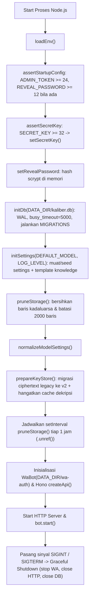
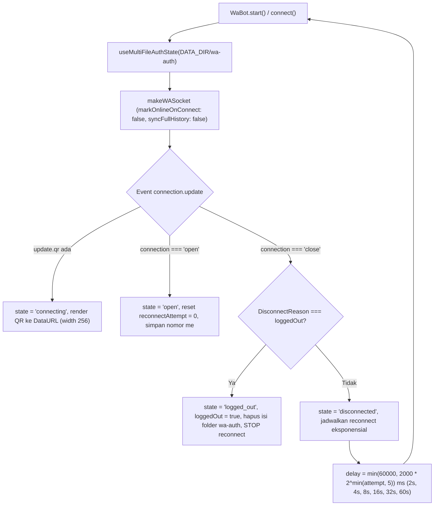
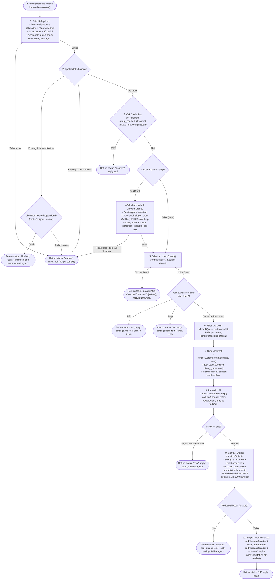

# PRD (Product Requirements Document) — Kaliber Bot

Dokumen spesifikasi teknis dan logika program lengkap untuk **Kaliber Bot** (Chatbot WhatsApp + Web Admin API untuk LSO Kaliber UMM Informatika). Dokumen ini berisi seluruh arsitektur, skema database, alur program (*flowchart*), algoritma rotasi provider/key, aturan keamanan, dan kontrak API **tanpa membahas tampilan/desain visual UI**, sehingga dapat diberikan langsung kepada AI coding agent untuk membangun ulang sistem yang identik dari nol.

---

## 1. Tujuan & Batasan Sistem

1. **Tujuan Utama**: Chatbot WhatsApp otomatis yang menjawab pertanyaan seputar LSO Kaliber hanya berdasarkan *knowledge base* yang dikelola admin lewat Web Admin, menggunakan LLM berformat OpenAI-compatible (`/v1/chat/completions` & `/v1/models`) atau Anthropic (`/v1/messages` & `/v1/models`), dipilih per provider.
2. **Target Lingkungan**: Perangkat terbatas seperti STB HG680P (`linux/arm64`, Cortex-A53, RAM kecil) maupun PC lokal.
   - **Satu proses Node.js** (`>= 22.13`, TypeScript ESM) menjalankan WhatsApp client + HTTP server sekaligus.
   - **Tanpa proses eksternal berat**: Tanpa Redis, tanpa ORM, tanpa worker thread, tanpa bundler frontend. Database menggunakan modul bawaan `node:sqlite` (`DatabaseSync`).
   - **Target memori**: RSS idle `< 150 MB` (dijalankan dengan `--max-old-space-size=128`).
3. **Prinsip Arsitektur Inti**:
   - **Pemisahan `pipeline.ts` dari Baileys**: `pipeline.ts` hanya menerima objek pesan terstruktur (`IncomingMessage`) dan mengembalikan `PipelineResult` (`{ reply, meta }`). Pengiriman ke WhatsApp dilakukan di `wa.ts`, sehingga endpoint simulasi `POST /api/test` mengeksekusi alur logika yang 100% sama dengan pesan WhatsApp asli.
   - **Hot-Reload Pengaturan**: Semua pengaturan disimpan di tabel `settings` SQLite dan di-cache di memori (`Map`). Setiap perubahan lewat API langsung memperbarui SQLite dan cache memori tanpa perlu restart proses.
   - **LLM Tanpa Tools**: Model LLM hanya menerima array `messages` (`system`, `user`, `assistant`) dengan `stream: false` dan tanpa *function calling/tools* untuk membatasi dampak *prompt injection*.

---

## 2. Struktur Modul Kode

```text
src/
  index.ts      Bootstrap aplikasi: validasi env, init DB, init settings, seed provider, start WA & HTTP, jadwal prune, graceful shutdown
  config.ts     Pembacaan environment variables, nilai DEFAULT_SETTINGS, DEFAULT_SYSTEM_PROMPT, DEFAULT_INJECTION_PATTERNS
  db.ts         Koneksi node:sqlite (WAL mode), migrasi berurutan (PRAGMA user_version), fungsi query log/audit/strike/mute, pruneStorage()
  settings.ts   Cache settings in-memory, initSettings(), getSetting(), getSettings(), updateSettings(), resetSettings()
  crypto.ts     Enkripsi/dekripsi API key (AES-256-GCM + scrypt KEK cache format v2), migrasi format legacy, verifikasi REVEAL_PASSWORD
  providers.ts  CRUD provider & key, rotasi key round-robin + cooldown, buildModelPlan()
  endpoint.ts   Normalisasi Base URL provider & generator kandidat URL (/v1/... dan non-/v1/...)
  wa.ts         Koneksi Baileys WhatsApp, QR/pairing code, auto-reconnect eksponensial, ekstraksi pesan & JID, kirim balasan + efek mengetik
  pipeline.ts   Alur utama pemrosesan pesan 10 langkah (bebas dari dependensi Baileys)
  guard.ts      Normalisasi teks (NFKC + homoglyph folding), validasi anti-ReDoS regex, blocklist/mute/allowlist, rate limit, cooldown grup, strike
  prompt.ts     Render system prompt ({{NOW}}, {{CONTACT}}, {{KNOWLEDGE}}), escape & bungkus input user dengan <pesan_user>
  llm.ts        Klien HTTP ke LLM (callLlm, pingLlm, probeProvider), budget waktu total, retry, fallback antar model/provider
  sanitize.ts   Pembersihan output LLM: buang <think>, hapus tag internal, deteksi bocor 8 kata berurutan & pola rahasia, konversi Markdown WA
  memory.ts     Riwayat percakapan per pengirim di SQLite (TTL 6 jam, dibatasi N giliran)
  queue.ts      Antrean serial per pengirim (per-key promise chain) + semaphore konkurensi global (maksimal 2 tugas LLM paralel)
  api.ts        HTTP server Hono: security headers, body limit 64 KB, Bearer auth + rate limit IP, seluruh route /api/* dan static asset
  logger.ts     Logger pino (level dinamis mengikuti settings.log_level)
public/
  index.html    Aplikasi SPA Web Admin ( memanggil /api/* dengan Authorization: Bearer <ADMIN_TOKEN> )
```

---

## 3. Variabel Lingkungan (`.env`) & Urutan Bootstrap

### 3.1 Daftar Variabel `.env`
| Variabel | Wajib? | Default | Aturan & Fungsi |
| :--- | :--- | :--- | :--- |
| `ADMIN_TOKEN` | **Wajib** | - | Minimal **24 karakter**. Jika kurang, proses menolak start (`throw Error`). Dipakai untuk Bearer auth ke `/api/*`. |
| `SECRET_KEY` | **Wajib** | - | Minimal **32 karakter**. Jika kurang, proses menolak start. Dipakai untuk menurunkan kunci enkripsi AES-256-GCM (`KEK`) bagi API key di SQLite. |
| `REVEAL_PASSWORD` | Opsional | `""` | Jika diisi, minimal **12 karakter**. Jika dikosongkan, fitur reveal otomatis menggunakan `ADMIN_TOKEN`. Di-hash dengan `scrypt` di memori saat start (tidak pernah masuk SQLite). Dipakai untuk fitur *reveal* API key. |
| `PORT` | Opsional | `3000` | Port HTTP server. |
| `HOST` | Opsional | `127.0.0.1` | Hostname binding HTTP server. |
| `TRUST_PROXY` | Opsional | `false` | Jika `true`, IP klien diambil dari header `CF-Connecting-IP` atau `X-Forwarded-For` pertama; jika `false`, diambil dari socket TCP langsung. |
| `DATA_DIR` | Opsional | `./data` | Direktori penyimpanan `kaliber.db` dan folder sesi Baileys `wa-auth/`. |
| `TZ` | Opsional | `Asia/Jakarta` | Zona waktu runtime. |
| `DEFAULT_MODEL` | Opsional | `""` | Seed model awal jika belum diatur lewat Web Admin. Jika dikosongkan kembali di `.env` dan model belum pernah disimpan manual dari Web Admin, model otomatis dikosongkan. |
| `LOG_LEVEL` | Opsional | `warn` | Seed awal untuk `settings.log_level` (`trace`/`debug`/`info`/`warn`/`error`/`fatal`). |

### 3.2 Flowchart Bootstrap & Shutdown (`src/index.ts`)



---

## 4. Skema Database SQLite & Retensi Data (`src/db.ts`)

Database dijalankan dengan:
- `PRAGMA journal_mode = WAL;`
- `PRAGMA synchronous = NORMAL;`
- `PRAGMA busy_timeout = 5000;`
- `PRAGMA foreign_keys = ON;` (diaktifkan setelah migrasi selesai)

### 4.1 Daftar Tabel
1. **`settings`**
   - `key TEXT PRIMARY KEY`
   - `value TEXT NOT NULL` (disimpan dalam format JSON string)
   - `updated_at INTEGER NOT NULL` (epoch ms)
2. **`messages`** (riwayat percakapan memori per pengguna)
   - `id INTEGER PRIMARY KEY AUTOINCREMENT`
   - `chat_id TEXT NOT NULL` (diisi `senderId` pengirim)
   - `role TEXT NOT NULL` (`'user'` atau `'assistant'`)
   - `content TEXT NOT NULL`
   - `ts INTEGER NOT NULL`
   - Index: `(chat_id, ts)`, `(ts)`
3. **`seen_messages`** (deduplikasi ID pesan WhatsApp)
   - `id TEXT PRIMARY KEY`
   - `ts INTEGER NOT NULL`
   - Index: `(ts)`
4. **`strikes`** (catatan pelanggaran prompt injection per JID)
   - `id INTEGER PRIMARY KEY AUTOINCREMENT`
   - `jid TEXT NOT NULL`
   - `ts INTEGER NOT NULL`
   - Index: `(jid, ts)`
5. **`mutes`** (daftar JID yang sedang di-mute karena melewati batas strike)
   - `jid TEXT PRIMARY KEY`
   - `until INTEGER NOT NULL` (epoch ms berakhirnya mute)
6. **`logs`** (catatan aktivitas pesan untuk dashboard & tabel log)
   - `id INTEGER PRIMARY KEY AUTOINCREMENT`
   - `ts INTEGER NOT NULL`
   - `chat_id TEXT NOT NULL`
   - `message TEXT NOT NULL` (dipotong maks 500 karakter)
   - `reply TEXT` (dipotong maks 1500 karakter, boleh `NULL`)
   - `status TEXT NOT NULL` (`'ok' | 'blocked' | 'injection' | 'ratelimit' | 'error'`)
   - `latency_ms INTEGER NOT NULL`
   - `model TEXT` (model yang menjawab, boleh `NULL`)
   - Index: `(ts)`
7. **`providers`** (daftar endpoint LLM berformat OpenAI-compatible atau Anthropic, maksimal 5 baris)
   - `id INTEGER PRIMARY KEY AUTOINCREMENT`
   - `name TEXT NOT NULL UNIQUE` (`^[a-z0-9][a-z0-9_-]{0,31}$`)
   - `base_url TEXT NOT NULL` (`^https?://`, dinormalisasi tanpa trailing slash/`/chat/completions`/`/models`)
   - `format TEXT NOT NULL DEFAULT 'openai'` (`openai` atau `anthropic`; ditambahkan lewat migrasi `ALTER TABLE`)
   - `enabled INTEGER NOT NULL DEFAULT 1` (`1` atau `0`)
   - `created_at INTEGER NOT NULL`
8. **`provider_keys`** (daftar API key per provider, maksimal 5 key per provider)
   - `id INTEGER PRIMARY KEY AUTOINCREMENT`
   - `provider_id INTEGER NOT NULL REFERENCES providers(id) ON DELETE CASCADE`
   - `label TEXT NOT NULL`
   - `key_encrypted TEXT NOT NULL` (ciphertext AES-256-GCM berprefix `v2:`)
   - `key_last4 TEXT NOT NULL` (4 karakter terakhir key asli)
   - `enabled INTEGER NOT NULL DEFAULT 1`
   - `cooldown_until INTEGER NOT NULL DEFAULT 0` (epoch ms)
   - `fail_count INTEGER NOT NULL DEFAULT 0`
   - `last_status TEXT NOT NULL DEFAULT ''` (`'' | 'valid' | 'invalid' | 'rate_limited' | 'unreachable' | 'error'`)
   - `last_checked_at INTEGER NOT NULL DEFAULT 0`
   - `created_at INTEGER NOT NULL`
   - Index: `(provider_id)`
9. **`audit_log`** (catatan audit setiap percobaan membuka/reveal API key)
   - `id INTEGER PRIMARY KEY AUTOINCREMENT`
   - `ts INTEGER NOT NULL`
   - `key_id INTEGER NOT NULL REFERENCES provider_keys(id) ON DELETE CASCADE`
   - `success INTEGER NOT NULL` (`1` atau `0`)
   - `ip TEXT NOT NULL`
   - `result TEXT NOT NULL DEFAULT ''` (`'ok' | 'wrong_password' | 'not_configured' | 'key_not_found' | 'decrypt_failed' | 'rate_limited' | 'no_password' | 'bad_request'`)
   - Index: `(ts)`

### 4.2 Aturan Retensi & Pembersihan Otomatis (`pruneStorage`)
Dijalankan saat startup dan setiap **1 jam**:
- Hapus `messages` dengan `ts < now - 6 jam`.
- Hapus `logs` dengan `ts < now - 7 hari`.
- Hapus `seen_messages` dengan `ts < now - 24 jam`.
- Hapus `strikes` dengan `ts < now - 24 jam`.
- Hapus `mutes` dengan `until < now`.
- Hapus `audit_log` dengan `ts < now - 90 hari`.
- Pangkas tabel `messages`, `logs`, `seen_messages`, dan `audit_log` agar masing-masing hanya menyisakan maksimal **2.000 baris terbaru** (`ORDER BY ts DESC LIMIT 2000`).

---

## 5. Koneksi WhatsApp & Siklus Hidup Sesi (`src/wa.ts`)



### 5.1 Aturan Penting WhatsApp (`WaBot`)
1. **Single Flight Connection**: Jika `connect()` sedang berjalan (`this.connections !== null`), pemanggilan `connect()` berikutnya menunggu promise yang sama (mencegah koneksi ganda paralel).
2. **Pairing Code (`requestPairing(phone)`)**:
   - Menolak jika `state === 'open'` atau `creds.registered === true`.
   - Jika sebelumnya `loggedOut === true`, bersihkan direktori `wa-auth` terlebih dahulu.
   - Menunggu socket siap (`waitForSocketOpen()`, timeout 15 detik), lalu memanggil `sock.requestPairingCode(phone)` dengan nomor hanya digit (awalan `0` diubah menjadi `62`, panjang 8–15 digit).
3. **Logout & Remote Logout**:
   - **Logout Manual (`logout()` / `POST /api/wa/logout`)**: Memanggil `sock.logout()` (fallback `sock.end()`), menghapus bersih direktori `wa-auth`, mereset state, dan langsung membuka koneksi baru (`connect()`) agar QR baru siap di-scan.
   - **Remote Logout (`DisconnectReason.loggedOut` / 401)**: Saat WhatsApp memutus sesi dari sisi ponsel, folder `wa-auth` dibersihkan dan koneksi baru (`void this.connect()`) langsung dibentuk ulang otomatis sehingga QR code baru segera tersedia di Web Admin.
   - **Pencegahan Reconnect Loop (`DisconnectReason.connectionReplaced` / 440)**: Jika status pemutusan adalah 440 (sesi digantikan oleh instance lain), auto-reconnect dihentikan untuk mencegah dua proses saling memutus koneksi.
   - **Guard Instance Socket**: Handler event `connection.update` dan `creds.update` menerapkan guard `if (this.sock !== sock) return;` agar instance socket lama yang tertutup tidak merusak siklus hidup instance socket baru.
   - **Kesiapan Socket untuk Pairing**: `waitForSocketOpen()` memvalidasi flag `this.socketReady` (diset setelah event `qr` pertama diterima atau status koneksi `open`) sebelum memanggil `sock.requestPairingCode(...)`.
4. **Resolusi Identitas Pengirim (`handleIncoming`)**:
   - Hanya memproses event `messages.upsert` dengan `type === 'notify'`.
   - Mengumpulkan kandidat JID pengirim dari `[participant, participantAlt, remoteJid, remoteJidAlt]`.
   - Mengutamakan JID yang berakhiran `@s.whatsapp.net` (nomor telepon/PN) sebagai `senderId` utama agar riwayat percakapan, rate limit, dan strike tetap konsisten meskipun WhatsApp mengirimkan `@lid`. JID lainnya disimpan di `altSenderIds` agar tetap dicocokkan terhadap blocklist/allowlist/mute.
5. **Deteksi Mention di Grup**:
   - Mengambil `contextInfo.mentionedJid` dari pesan (`conversation`, `extendedTextMessage`, `imageMessage`, `videoMessage`, `documentMessage`).
   - Menormalisasi setiap JID mention dengan `jidNormalizedUser` dan mencocokkannya terhadap seluruh identitas bot (`creds.me.id`, `creds.me.lid`, `creds.me.phoneNumber`, `sock.user.id`, `sock.user.lid`).
6. **Pengiriman Balasan**:
   - Jika `pipeline.handleMessage()` mengembalikan `reply` tidak kosong:
     1. Kirim status mengetik: `sock.sendPresenceUpdate('composing', chatId)`.
     2. Tunggu jeda manusiawi acak **1.000 – 3.000 ms** (`1000 + Math.floor(Math.random() * 2000)`).
     3. Kirim pesan: jika di grup gunakan `{ quoted: msg }`, jika chat pribadi kirim tanpa quote.

---

## 6. Alur Pipeline Pemrosesan Pesan 10 Langkah (`src/pipeline.ts`)



> **Catatan `admin-test`**: Jika `chatId === 'admin-test'` (berasal dari `POST /api/test`), parameter `bypassLimits: true` dikirim ke `checkGuard()` sehingga pemeriksaan **blocklist, mute, allowlist, rate limit, group cooldown, dan pencatatan strike dilewati**, namun pemeriksaan **batas panjang karakter (`max_input_chars`) dan deteksi regex prompt injection tetap dijalankan**.

---

## 7. Sistem Guard, Normalisasi, & Anti-Injeksi (`src/guard.ts`)

### 7.1 Normalisasi Teks & Homoglyph Folding
Sebelum teks diperiksa oleh panjang karakter maupun regex injeksi:
1. **`normalizeText(input)`**:
   - Normalisasi Unicode `NFKC`.
   - Hapus karakter *zero-width* dan *invisible formatting* (`\u00AD`, `\u034F`, `\u061C`, `\u180E`, `\u200B-\u200F`, `\u202A-\u202E`, `\u2060-\u206F`, `\uFEFF`, `\uFFF9-\uFFFB`).
   - Ganti karakter kontrol (`\u0000-\u0008`, `\u000B`, `\u000C`, `\u000E-\u001F`, `\u007F`) menjadi spasi.
   - Satukan spasi berurutan (`\s+` -> `' '`) dan `trim()`.
2. **`foldConfusables(input)`** (untuk deteksi injeksi):
   - Petakan huruf Cyrillic & Yunani yang mirip huruf Latin (`а->a`, `е->e`, `і->i`, `о->o`, `р->p`, `с->c`, `у->y`, `х->x`, `ѕ->s`, `α->a`, `ε->e`, `ι->i`, `ο->o`).
   - Dekomposisi `NFD`, buang seluruh *combining diacritical marks* (`[\u0300-\u036f]`), lalu kembalikan ke `NFC`.

### 7.2 Urutan 7 Lapisan Guard (`checkGuard`)
Dieksekusi berurutan; begitu satu lapisan menolak, lapisan berikutnya tidak dijalankan:
1. **Blocklist** *(dilewati bila `bypassLimits`)*: Cocokkan semua `senderJids` dan digit nomor teleponnya terhadap `settings.blocklist`. Jika cocok -> `status: 'blocked'`, `reply: null`, `flags: ['blocklist']`.
2. **Mute** *(dilewati bila `bypassLimits`)*: Cek tabel `mutes` apakah ada `jid` dengan `until > now`. Jika ya -> `status: 'blocked'`, `reply: null`, `flags: ['muted']`.
3. **Allowlist** *(dilewati bila `bypassLimits`)*: Jika `settings.allowlist_enabled === true` dan pengirim tidak ada di `settings.allowlist` -> `status: 'blocked'`, `reply: null`, `flags: ['allowlist']`.
4. **Batas Panjang Karakter**: Jika `normalized.length > settings.max_input_chars` -> `status: 'blocked'`, `reply: "Pesannya kepanjangan, maksimal <N> karakter ya 🙏"`, `flags: ['too_long']`.
5. **Rate Limit Per Nomor** *(dilewati bila `bypassLimits`)*: Sliding window **60 detik** di memori (`rateBuckets`) per `primary` JID. Jika jumlah pesan dalam 60 detik terakhir `>= settings.rate_limit_per_min` -> `status: 'ratelimit'`, `reply: null`, `flags: ['rate_limit']`.
6. **Group Cooldown** *(hanya jika `isGroup && !bypassLimits`)*: Cek waktu terakhir grup dijawab (`groupLast`). Jika `now - last < settings.group_cooldown_sec * 1000` -> `status: 'ratelimit'`, `reply: null`, `flags: ['group_cooldown']`.
7. **Deteksi Prompt Injection (`matchesInjection`)**:
   - Potong teks yang dipindai maksimal **2.000 karakter** (`MAX_INJECTION_SCAN_CHARS`).
   - Uji setiap regex (flag `i`) terhadap:
     1. Teks `bounded` (hasil `normalizeText`),
     2. Teks `folded` (hasil `foldConfusables`),
     3. Teks `flat` (seluruh spasi, titik, garis bawah, dan tanda hubung `[\s._-]+` dihapus) terhadap versi *squashed regex* (agar tetap menangkap bypass seperti `a b a i k a n` atau `i.g.n.o.r.e`).
   - Jika cocok:
     - Bila `!bypassLimits`, panggil `registerStrike(primary, now, settings)`:
       - Hapus strike milik `jid` yang lebih tua dari `strike_window_min` menit.
       - Tambahkan 1 baris ke tabel `strikes`.
       - Hitung total strike aktif dalam jendela waktu. Jika `count >= settings.strike_limit`: masukkan `jid` ke tabel `mutes` selama `mute_minutes` menit, hapus strike `jid` tersebut, dan tambahkan flag `'muted_after_strikes'`.
     - Kembalikan `status: 'injection'`, `reply: settings.refusal_text`, `flags: ['injection', 'strike:<N>']`.

### 7.3 Validasi Anti-ReDoS pada Regex Injeksi (`isUnsafeRegex` & `compilePatterns`)
Karena `injection_patterns` dapat diedit admin lewat Web Admin, setiap pola wajib divalidasi sebelum disimpan maupun sebelum dieksekusi:
- Maksimal **50 pola** (`MAX_PATTERNS = 50`), panjang per pola maksimal **300 karakter** (`MAX_PATTERN_LEN = 300`).
- Tolak jika mengandung *backreference* (`\[1-9]`).
- Tolak jika mengandung quantifier kurung kurawal `{m,n}` dengan batas `> 100`.
- Tolak jika terdapat grup `(...)` yang di dalamnya sudah memiliki pengulangan (`+`, `*`, atau `{2,}`) lalu grup tersebut diikuti lagi oleh quantifier pengulangan (*nested quantifier* seperti `(a+)+` atau `(.*a){2,}`).
- Uji waktu eksekusi (`re.test('a'.repeat(28) + '!')`) untuk regex asli dan *squashed regex*; jika memakan waktu `> 25 ms`, tolak pola tersebut.

---

## 8. Penyusunan Prompt & Sanitasi Output (`src/prompt.ts` & `src/sanitize.ts`)

### 8.1 Konstruksi Messages (`buildMessages`)
1. **System Message (`role: 'system'`)**:
   - Mengambil `settings.system_prompt`. Jika tidak memuat placeholder `{{KNOWLEDGE}}`, otomatis ditambahkan `\n\n<info_kaliber>\n{{KNOWLEDGE}}\n</info_kaliber>` di bagian akhir.
   - Mengganti placeholder `{{NOW}}` (waktu format Indonesia WIB, contoh: `Minggu, 8 November 2026 16.05 WIB`), `{{CONTACT}}`, dan `{{KNOWLEDGE}}`.
   - **Invarian Keamanan**: Teks dari pengguna tidak pernah disisipkan ke dalam `system` message.
2. **Riwayat Percakapan (`history`)**:
   - Diambil dari tabel `messages` untuk `senderId` yang bersangkutan, maksimal `settings.history_turns * 2` pesan terakhir.
   - Jika pesan paling akhir dari pengirim tersebut sudah berumur **> 6 jam** (`HISTORY_TTL_MS`), seluruh riwayat dianggap kadaluarsa (kosong) agar konteks topik lama tidak mencemari percakapan baru.
   - Setiap pesan `user` di riwayat dibungkus ulang dengan `<pesan_user>...</pesan_user>`.
3. **Pesan Pengguna Saat Ini (`role: 'user'`)**:
   - Semua kemunculan tag `<pesan_user>`, `</pesan_user>`, `<info_kaliber>`, `</info_kaliber>` (beserta variasi spasi atau atribut di dalamnya) di-*escape* menjadi `&lt;...&gt;`.
   - Dibungkus menjadi `<pesan_user>${escaped}</pesan_user>`.

### 8.2 Sanitasi Output LLM (`sanitizeOutput`)
Setiap jawaban dari LLM melewati tahapan berikut:
1. **Hapus `<think>` (`stripThink`)**: Menghapus blok `<think>...</think>` maupun `<think>...` yang tidak tertutup sampai akhir teks (untuk model *reasoning* seperti DeepSeek/Qwen).
2. **Hapus Tag Internal**: Menghapus tag `<info_kaliber>`, `<pesan_user>`, `<system>`, `<assistant>`, `<think>`.
3. **Deteksi Kebocoran (`leaksPrompt`)**:
   - **Pola Rahasia**: Cek regex `sk-[A-Za-z0-9_-]{10,}`, `gsk_[A-Za-z0-9_-]{10,}`, `Bearer \S+`, `ROUTER_KEY`, `ADMIN_TOKEN`, `SECRET_KEY`, `REVEAL_PASSWORD`.
   - **8-Word Shingle Leak Detection**: Ambil teks `systemPrompt` di luar blok `<info_kaliber>...</info_kaliber>` (agar isi knowledge base yang memang harus dijawab ke user tidak dianggap kebocoran). Ekstrak daftar kata alfanumerik huruf kecil. Jika ada **8 kata berurutan** di output LLM yang sama persis dengan 8 kata berurutan di instruksi `systemPrompt`, tandai `leaked: true`.
   - Jika `leaked === true`, ganti seluruh balasan dengan `settings.fallback_text`, beri status `'blocked'` dan flag `'output_leak'`, serta **jangan simpan ke riwayat `messages`**.
4. **Konversi Markdown WhatsApp (`toWhatsAppMarkdown`)**:
   - Hapus heading `# ...` di awal baris.
   - Ubah bold `**teks**` menjadi `*teks*`.
   - Ubah strikethrough `~~teks~~` menjadi `~teks~`.
   - Buang baris tabel Markdown (baris yang memiliki `>= 2` karakter `|`).
   - Rapikan baris kosong berlebih (`\n{3,}` menjadi `\n\n`).
5. **Pemotongan Panjang**: Batasi maksimal **1.500 karakter** (tanpa memotong di tengah *UTF-16 surrogate pair* emoji).

---

## 9. Manajemen Multi-Provider, Enkripsi Key, & Algoritma Rotasi (`src/providers.ts`, `src/llm.ts`, `src/crypto.ts`)

### 9.1 Enkripsi API Key (`src/crypto.ts`)
- Menggunakan **AES-256-GCM** (`iv` 12 byte acak per enkripsi, `authTag` 16 byte).
- Kunci enkripsi (`KEK`, 32 byte) diturunkan **sekali per proses** dari `SECRET_KEY` memakai `scryptSync(secretKey, 'kaliber-bot/kek/v2', 32)` dan disimpan di variabel memori `derivedKek`.
- Format penyimpanan di kolom `provider_keys.key_encrypted`:
  `v2:<base64(iv[12] || authTag[16] || ciphertext)>`
- Hasil dekripsi di-cache di memori (`decryptedKeys` Map, maks 200 entri) berdasarkan `key.id`, dan diinvalidasi setiap kali key diubah atau dihapus.
- **Masking**: API tidak pernah mengirimkan `key_encrypted` atau plaintext key pada endpoint `GET`. Hanya `keyLast4` (4 karakter terakhir) yang dikirim ke klien.
- **Reveal Key (`POST /api/keys/:id/reveal`)**:
  - Memerlukan verifikasi password (menggunakan `ADMIN_TOKEN` secara bawaan, atau `REVEAL_PASSWORD` jika disetel di `.env`).
  - Verifikasi password menggunakan `scryptSync` + `timingSafeEqual` (panjang password dibatasi maks 256 karakter).
  - Dibatasi rate limit **5 kegagalan / 15 menit / IP** (HTTP 429).
  - Setiap percobaan (berhasil maupun gagal) wajib dicatat ke tabel `audit_log` beserta alasan (`result`).

### 9.2 Pemilihan & Mode Routing Model (`buildModelPlan`)

Provider tidak memiliki model default, prioritas, maupun strategi pemanggilan otomatis. Manajemen model dipusatkan sepenuhnya di **Tab Model** melalui pemilih mode routing dan tabel prioritas interaktif (mendukung hingga **20 model**):
- **Mode Routing (`settings.model_mode`)**:
  - `fallback` (bawaan): Model dipanggil berurutan mulai dari nomor 1 (Model Utama). Jika gagal (timeout/error/rate limit), otomatis beralih ke Model Cadangan nomor 2, 3, dan seterusnya.
  - `round_robin`: Model nomor 1 sampai N dipanggil bergiliran (rotasi counter in-memory) untuk meratakan beban antar model. Jika model yang sedang bergiliran gagal, sistem otomatis melakukan fallback berantai ke model berikutnya dalam rotasi.
  - `fusion`: Pertanyaan pengguna dikirim bersamaan ke panel model teratas (maksimal 3 model secara paralel via `Promise.allSettled`). Jawaban yang berhasil kemudian disintesis oleh model utama menjadi satu jawaban akhir terbaik dalam Bahasa Indonesia. Jika hanya 1 model yang berhasil atau sintesis gagal, sistem melakukan degradasi anggun (graceful degradation) langsung menggunakan jawaban terbaik tanpa error.
- **Model Utama (`settings.model`)**: Model urutan ke-1 pada tabel prioritas yang pertama kali dipanggil untuk menjawab pesan.
- **Model Cadangan (`settings.fallback_models`)**: Model urutan ke-2 sampai ke-20 pada tabel yang dipanggil berurutan jika model di atasnya gagal atau terkena limit.
- **Pembersihan Berantai saat Provider Dihapus (`deleteProvider`)**: Menghapus provider otomatis membersihkan seluruh referensi model berawalan `namaProvider/` dari `settings.model` dan `settings.fallback_models`. Jika model utama terhapus, model cadangan pertama yang tersisa otomatis dipromosikan menjadi model utama. Jika tidak ada provider tersisa, model dikosongkan.
- **Penyesuaian Berantai saat Provider Diubah Nama (`updateProvider`)**: Jika nama provider diubah, seluruh entri model `namaLama/...` otomatis disesuaikan menjadi `namaBaru/...`.

### 9.3 Resolusi Key & Rotasi di Dalam Provider (`resolveModel`)
Saat `callLlm` mencoba memanggil kandidat model `namaProvider/namaModel` (atau `namaModel` tanpa prefix):
1. Jika model memiliki prefix `namaProvider/`:
   - Cari provider di DB berdasarkan `name`.
   - Jika provider ditemukan tetapi `enabled === false`, langsung kembalikan `null` (lewati kandidat ini, **jangan** dialihkan ke provider default).
   - Jika prefix bukan nama provider yang terdaftar di DB (misal nama model bawaan seperti `openai/gpt-oss-120b` ketika hanya ada 1 provider `default`), gunakan provider aktif pertama (`ORDER BY id ASC LIMIT 1`) dan kirim seluruh string model apa adanya.
2. Ambil semua key milik provider tersebut:
   - Jika provider **tidak memiliki baris key sama sekali** (`allKeys.length === 0`, misalnya 9router lokal tanpa autentikasi), izinkan request dengan `apiKey: ""`.
   - Jika provider memiliki key, saring yang `enabled === 1`. Jika tidak ada yang aktif, kembalikan `null`.
   - Saring key yang sedang tidak cooldown (`cooldown_until <= now`).
   - Jika semua key aktif sedang cooldown, pilih **1 key dengan `cooldown_until` paling dekat/kecil** sebagai upaya terakhir.
   - Pilih key secara **round-robin** per provider menggunakan counter di memori: `candidates[counter % candidates.length]`, lalu naikkan counter provider tersebut.

### 9.4 Timeout, Budget Waktu, Retry, & Cooldown Key (`callLlm`)
1. **Total Time Budget**: Setiap pemanggilan `callLlm` memiliki batas waktu total **`totalBudgetMs = 75.000 ms` (75 detik)** dan timeout per request **`30.000 ms`**. Jika sisa budget `< 3.000 ms`, hentikan percobaan dan kembalikan `fallback_text`.
2. **Format Provider & Normalisasi Endpoint**:
   - **Format OpenAI-compatible (`format: 'openai'`)**: Menggunakan kandidat endpoint `/chat/completions` (dengan dan tanpa `/v1`), header `Authorization: Bearer <apiKey>`, dan payload `{ model, messages, temperature, max_tokens, stream: false }`.
   - **Format Anthropic (`format: 'anthropic'`)**: Menggunakan kandidat endpoint `/messages` (dengan dan tanpa `/v1`), header `x-api-key: <apiKey>` dan `anthropic-version: 2023-06-01`, payload `{ model, messages, system?, temperature, max_tokens, stream: false }` dengan memisahkan instruksi sistem dan memastikan giliran `user`/`assistant` berselang-seling.
   - Output diekstrak secara agnostik format dari `choices[0].message.content` (OpenAI) maupun `content[].text` (Anthropic).
3. **Aturan Cooldown & Status Key saat Gagal (`markKeyFailed`)**:
   - Naikkan `fail_count = fail_count + 1` dan perbarui `last_checked_at = now`.
   - Jika provider hanya punya **1 key aktif** (`!otherKey`), `cooldown_until` tetap `0` agar tidak mengunci satu-satunya key.
   - Jika provider punya `> 1` key aktif, pasang cooldown pada key yang gagal:
     - `HTTP 401 / 403`: `last_status = 'invalid'`, cooldown **30 menit**.
     - `HTTP 429`: `last_status = 'rate_limited'`, cooldown mengikuti header `Retry-After` (dibatasi maks **60 detik**, default **30 detik**).
     - `HTTP >= 500` atau error jaringan/timeout (`status = 0`): `last_status = 'error'` / `'unreachable'`, cooldown **5 detik**.
4. **Retry**: Maksimal 2 percobaan (`attempt 0` dan `attempt 1`) per kandidat model. Percobaan ke-2 hanya dilakukan jika provider memiliki `> 1` key sehat atau kandidat tersebut adalah kandidat terakhir.
5. **Reset saat Berhasil (`markKeySucceeded`)**: Saat key berhasil menghasilkan jawaban tidak kosong, reset `fail_count = 0`, `cooldown_until = 0`, `last_status = 'valid'`, dan `last_checked_at = now`.

### 9.5 Probe / Tes Validitas Key 2 Tahap (`probeProvider`)
Digunakan untuk tombol **Tes** per key, **Tes koneksi** provider, maupun **Tes dulu** sebelum menyimpan di modal:
1. Validasi `baseUrl` wajib `http:` atau `https:`, dengan `redirect: 'manual'` (tolak 3xx redirect).
2. **Tahap 1 (`GET /models`, timeout 8 detik)**:
   - Jika `401/403` -> selesai dengan `ok: false, status: 'invalid'`.
   - Jika `429` -> selesai dengan `ok: true, status: 'rate_limited'`.
   - Jika `200 OK` -> ekstrak daftar ID model dari `data[].id` (maks 500 model).
   - Jika `404/405` -> lanjut ke Tahap 2 (karena sebagian provider tidak menyediakan endpoint `/models`).
3. **Tahap 2 (`POST /chat/completions`, timeout 15 detik)**:
   - Tentukan `modelToTest = opts.model || models[0] || ''`.
   - Jika `modelToTest` kosong: bila Tahap 1 berhasil (`200 OK`), kembalikan `ok: true, status: 'valid'` dengan catatan belum dites chat; bila Tahap 1 gagal, kembalikan `ok: false, status: 'error'`.
   - Kirim `messages: [{ role: 'user', content: 'ping' }], max_tokens: 5, temperature: 0, stream: false`.
   - Evaluasi respons:
     - `2xx`: `ok: true, status: 'valid', chatOk: true` (serta me-reset `cooldown_until = 0, fail_count = 0` di DB bila key sudah tersimpan).
     - `401/403`: `ok: false, status: 'invalid'`.
     - `429`: `ok: true, status: 'rate_limited'`.
     - `400/404`: `ok: false, status: 'error'` (model ditolak/tidak ditemukan).

---

## 10. Antrean Pesan & Konkurensi (`src/queue.ts`)

`MessageQueue` menjaga agar perangkat berdaya rendah tidak kehabisan CPU/RAM saat banyak pesan masuk bersamaan:
1. **Serial per Nomor (`chains: Map<string, Promise<void>>`)**:
   - Pesan dari `senderId` yang sama dieksekusi berurutan satu per satu (pesan ke-2 dari nomor yang sama menunggu pesan ke-1 selesai dan tersimpan ke riwayat `messages`).
   - Setelah promise terakhir dari `senderId` selesai, entri di `chains` dihapus otomatis (`if (this.chains.get(key) === tail) this.chains.delete(key)`) agar tidak terjadi kebocoran memori.
2. **Semaphore Global (`concurrency = 2`)**:
   - Maksimal hanya **2 request LLM** yang boleh berjalan paralel di seluruh bot pada satu waktu. Tugas lainnya mengantre di array `waiting` FIFO.
   - Pelepasan slot (`this.release()`) wajib berada di dalam blok `finally` agar error pada satu tugas tidak pernah membuat antrean macet.

---

## 11. Spesifikasi Keamanan & Kontrak HTTP API (`src/api.ts`)

### 11.1 Lapisan Keamanan HTTP Server
1. **Header Keamanan Wajib** (dipasang di semua respons termasuk 401/404/413/500):
   - `Content-Security-Policy: default-src 'self'; style-src 'self' 'unsafe-inline'; script-src 'self' 'unsafe-inline'; img-src 'self' data:; connect-src 'self'`
   - `X-Frame-Options: DENY`
   - `Referrer-Policy: no-referrer`
   - `X-Content-Type-Options: nosniff`
2. **Batas Ukuran Body**: Semua request ke `/api/*` dibatasi maksimal **64 KB (`65.536 byte`)** menggunakan streaming body limit (`hono/body-limit`). Jika lewat, balas `413 { error: 'body terlalu besar' }`.
3. **Autentikasi Admin & Rate Limit Brute-Force**:
   - Semua `/api/*` wajib menyertakan header `Authorization: Bearer <ADMIN_TOKEN>`.
   - Token dibandingkan secara *constant-time* dengan meng-hash kedua nilai memakai `SHA-256` lalu memanggil `timingSafeEqual(givenHash, expectedHash)` (sehingga perbedaan panjang token tidak melempar exception atau membocorkan panjang token).
   - Kegagalan autentikasi dicatat per IP (`loginFailures`). Jika mencapai **5 gagal dalam 60 detik**, balas `429 { error: 'terlalu banyak percobaan, coba lagi nanti' }`. Saat login berhasil, riwayat gagal untuk IP tersebut dihapus.
4. **Anti-SSRF pada Update Provider (`PUT /api/providers/:id`)**:
   - Jika admin mengubah `baseUrl` sebuah provider yang sudah memiliki API key tersimpan menjadi URL yang berbeda, server menolak dengan `400` (*"Hapus semua API key pada provider ini terlebih dahulu sebelum mengubah Base URL"*). Ini mencegah penyerang mengganti `baseUrl` ke server miliknya untuk mencuri `Authorization: Bearer <saved_key>` saat memicu tes koneksi.

### 11.2 Daftar Lengkap Endpoint HTTP

| Method & Path | Auth | Deskripsi & Logika Utama |
| :--- | :--- | :--- |
| `GET /healthz` | Publik | Mengembalikan `{ ok: true, uptimeSec, rssMb }`. |
| `GET /` | Publik | Menyajikan `public/index.html` (`Cache-Control: no-store`). |
| `GET /kaliber.avif` | Publik | Menyajikan aset logo `public/kaliber.avif` (`Content-Type: image/avif`). |
| `GET /api/settings` | Bearer | Mengembalikan `{ settings, defaults, limits: { knowledge_warn_chars: 12000, body_bytes: 65536 }, has_reveal_password }`. |
| `PUT /api/settings` | Bearer | Memvalidasi *whitelist* key, tipe data, rentang angka, batas panjang string, enum `log_level`, serta uji anti-ReDoS `injection_patterns`. Menyimpan secara atomik ke SQLite & cache memori. |
| `GET /api/status` | Bearer | Mengembalikan snapshot WA (`state`, `qrDataUrl`, `pairingCode`, `me`, `lastError`), status bot, `uptimeSec` (diformat eksplisit di UI dengan satuan `hari`, `jam`, `mnt`, `dtk`), `rssMb`, statistik hari ini (`messagesToday`, `blockedToday`), `strikes`, `mutes`, dan `model` efektif. |
| `POST /api/wa/pairing` | Bearer | Body `{ phone }`. Meminta 8-karakter pairing code WhatsApp ke Baileys. |
| `POST /api/wa/logout` | Bearer | Memutuskan sesi WhatsApp, menghapus `wa-auth`, dan memulai sesi baru. |
| `POST /api/bot/toggle` | Bearer | Body `{ enabled?: boolean }`. Mengubah `settings.bot_enabled`. |
| `POST /api/test` | Bearer | Body `{ text }`. Menjalankan `handleMessage({ chatId: 'admin-test', senderId: 'admin-test', text })` tanpa mengirim ke WhatsApp. |
| `GET /api/logs` | Bearer | Mengembalikan 100 baris terakhir dari tabel `logs` (`ORDER BY ts DESC, id DESC LIMIT 100`). |
| `DELETE /api/logs` | Bearer | Menghapus seluruh baris riwayat aktivitas pesan dari tabel `logs`. |
| `GET /api/console` | Bearer | Query `?since=<id>`. Mengembalikan log proses realtime (buffer in-memory maks 300 entri). |
| `DELETE /api/console` | Bearer | Mengosongkan buffer console log proses realtime. |
| `GET /api/audit` | Bearer | Mengembalikan 50 baris terakhir dari tabel `audit_log` (`ORDER BY ts DESC, id DESC LIMIT 50`). |
| `POST /api/llm/ping` | Bearer | Menguji koneksi LLM aktif menggunakan rencana dari `buildModelPlan(settings)`. |
| `POST /api/llm/test` | Bearer | Body `{ baseUrl, format?, apiKey?, model?, providerId?, keyId? }`. Menjalankan `probeProvider()` untuk menguji kombinasi URL/key/model sebelum maupun sesudah disimpan. Selalu membalas HTTP 200 dengan objek `ProbeResult`. |
| `GET /api/models` | Bearer | Mengambil daftar model secara paralel (`GET /models`) dari seluruh provider yang aktif. |
| `GET /api/providers` | Bearer | Mengembalikan `{ providers, maxProviders: 5, maxKeysPerProvider: 5, serverNow }` (tanpa `keyEncrypted`). |
| `POST /api/providers` | Bearer | Body `{ name, baseUrl, format?, apiKey, keyLabel? }`. `format` bernilai `openai` (bawaan) atau `anthropic`. `apiKey` **wajib**; provider dan key pertamanya disimpan atomik. Membuat provider baru (maks 5; balas `409` jika penuh atau nama duplikat, `400` jika `apiKey` kosong). |
| `PUT /api/providers/:id` | Bearer | Body `{ name?, baseUrl?, format?, enabled? }`. Memperbarui provider. |
| `DELETE /api/providers/:id` | Bearer | Menghapus provider beserta seluruh key-nya + invalidasi cache key. |
| `POST /api/providers/:id/toggle` | Bearer | Body `{ enabled: boolean }`. Mengaktifkan/menonaktifkan provider. |
| `POST /api/providers/:id/test` | Bearer | Menguji provider memakai key aktif yang sehat (`probeProvider`) dan menyimpan status hasil tes ke key tersebut. |
| `GET /api/providers/:id/models` | Bearer | Mengambil daftar model dari satu provider tertentu. |
| `POST /api/providers/:id/keys` | Bearer | Body `{ label, apiKey }`. Mengenkripsi `apiKey` (AES-256-GCM v2) dan menyimpannya (maks 5 key/provider; balas `409` jika penuh). |
| `DELETE /api/providers/:id/keys/:keyId` | Bearer | Menghapus 1 API key + invalidasi cache dekripsi. |
| `POST /api/providers/:id/keys/:keyId/toggle` | Bearer | Body `{ enabled: boolean }`. Mengaktifkan/menonaktifkan 1 API key. |
| `POST /api/providers/:providerId/keys/:keyId/test` | Bearer | Menguji 1 API key spesifik dengan `probeProvider` dan memperbarui `last_status` serta `last_checked_at` di DB. |
| `POST /api/keys/:id/reveal` | Bearer | Body `{ password }`. Memverifikasi password (`ADMIN_TOKEN` atau `REVEAL_PASSWORD`), mencatat ke `audit_log`, dan mengembalikan `{ ok: true, keyId, label, plainKey }`. |

### 11.3 Aturan Validasi `PUT /api/settings`
- **Boolean**: `bot_enabled`, `private_enabled`, `group_enabled`, `allowlist_enabled`.
- **Rentang Angka (`NUMBER_RANGES`)**:
  - `temperature`: `0` s/d `2`
  - `max_tokens`: `1` s/d `2000` (integer)
  - `history_turns`: `0` s/d `20` (integer)
  - `max_input_chars`: `20` s/d `5000` (integer)
  - `rate_limit_per_min`: `1` s/d `120` (integer)
  - `group_cooldown_sec`: `0` s/d `3600` (integer)
  - `strike_limit`: `1` s/d `20` (integer)
  - `strike_window_min`: `1` s/d `1440` (integer)
  - `mute_minutes`: `1` s/d `10080` (integer)
- **Batas Panjang String (`STRING_LIMITS`)**:
  - `system_prompt`: maks `20.000` karakter
  - `knowledge`: maks `50.000` karakter (peringatan di UI jika `> 12.000` karakter)
  - `fallback_text`, `refusal_text`, `info_text`, `help_text`: masing-masing maks `2.000` karakter
  - `contact`, `model`: masing-masing maks `200` karakter
  - `trigger_prefix`: maks `32` karakter
  - `log_level`: enum `'trace' | 'debug' | 'info' | 'warn' | 'error' | 'fatal'`
- **Array String (`LIST_KEYS`)**:
  - `allowed_groups`, `blocklist`, `allowlist`, `fallback_models`: maks `200` item, tiap item maks `300` karakter.
  - `injection_patterns`: maks `50` item, tiap item maks `300` karakter, wajib lolos `invalidPatterns()` (kompilasi RegExp + uji anti-ReDoS).
